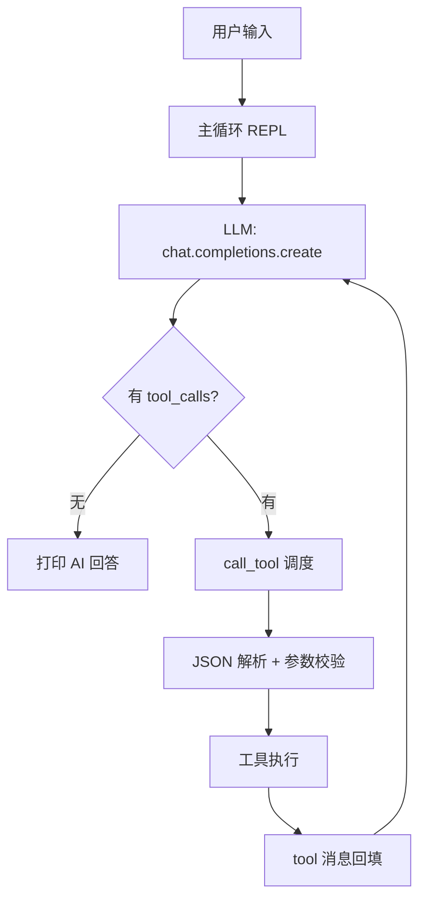

# Practice02 - 本地文件操作 Function Call 助手

基于 `main.py` 扩展的极简 AI 助手，通过 OpenAI Function Call 协议新增一组本地文件操作工具，LLM 可直接读写、管理本地文件与目录。

## 架构图

见 [architecture.mmd](architecture.mmd)（Mermaid 格式，可使用支持 Mermaid 的工具渲染，如 VS Code 插件、mermaid.live）。



## 文件说明

| 文件 | 说明 |
|---|---|
| `file_tools.py` | 主程序，含全部 12 个工具定义与调度逻辑 |
| `main.py` | 原始版本，仅含 `getDate` / `isLeapYear` 两个工具 |
| `config.ini` | LLM 配置（api_key、base_url、model_name） |
| `architecture.mmd` | 代码架构图（Mermaid 源文件） |

## 运行

```bash
pip install openai
python file_tools.py
```

REPL 命令：`/clear` 清空记忆，`/exit` 或 `/quit` 退出。

## 工具列表

### 原有工具

| 工具 | 功能 | 实现 |
|---|---|---|
| `getDate` | 获取当前日期时间 | `subprocess` 调用本地 `date` / `time` 命令 |
| `isLeapYear` | 判断闰年 | Python 计算 |

### 本地文件操作工具

| 工具 | 功能 | 参数 | 实现 |
|---|---|---|---|
| `getcwd` | 获取当前工作目录 | — | `os.getcwd()` |
| `listDir` | 列出目录下所有文件和子目录 | `path`（可选，默认当前目录） | `os.listdir()`，逐项标记 `[文件]` / `[目录]` |
| `getFileType` | 获取文件类型（扩展名、MIME 类型、大小） | `path` | `mimetypes.guess_type()` |
| `readFile` | 读取纯文本文件内容 | `path` | 按 utf-8 → gbk 顺序探测解码；含 `\x00` 判定为二进制并拒绝 |
| `createFile` | 创建新文件（目录不存在时自动递归创建） | `dir`（可选）、`filename`、`content`（可选） | `os.makedirs(exist_ok=True)` + `open(..., "w")` |
| `editFile` | 编辑文件：将 `old_text` 全部替换为 `new_text`，`new_text` 为空则删除 | `path`、`old_text`、`new_text`（可选） | `str.replace()`；纯文本校验同 `readFile` |
| `createDir` | 创建新目录（递归创建上级目录） | `path` | `os.makedirs(exist_ok=True)` |
| `removeDir` | 删除非空目录及其所有内容 | `path` | `shutil.rmtree()` |
| `removeFile` | 删除文件 | `path` | `os.remove()` |
| `renamePath` | 重命名 / 移动文件或目录 | `old_path`、`new_path` | `shutil.move()`，目标已存在时报错 |

## 工具调度流程

```
用户输入 → LLM 返回 tool_calls
        → call_tool(name, args_json)
        → ALLOWED_TOOLS 名称白名单校验
        → json.loads 解析参数
        → TOOL_SPECS 必填参数校验
        → 调用对应 Python 函数
        → 结果字符串回填 tool 消息 → 继续对话
```

所有工具统一返回字符串结果；错误（未知工具、JSON 解析失败、缺少参数、路径不存在、二进制文件读写等）均以中文提示信息返回给模型，由模型转述给用户。

## 安全说明

- `removeDir`、`removeFile`、`editFile` 等为不可逆操作，工具描述中已提示模型在执行前与用户确认。
- `readFile` / `editFile` 仅支持纯文本，通过空字节 `\x00` 检测拦截二进制文件。
